<!-- capa -->
FACULDADE DE EDUCAÇÃO E CULTURA FRANCISCO ANTÔNIO FERNANDES – FECAF

CURSO DE GESTÃO DE TECNOLOGIA

ANDRÉ MARCELINO

ENGENHEIRO DE CORRIDA VIRTUAL: aprendizado de máquina aplicado à telemetria do F1 23 para avaliar o efeito do acerto do carro no tempo de volta em Mônaco

Artigo científico apresentado à disciplina de Machine Learning / Deep Learning do curso de Gestão de Tecnologia da FECAF.

Taboão da Serra

2026
<!-- /capa -->

<!-- quebra -->

<!-- sumario -->
SUMÁRIO

1 INTRODUÇÃO

2 MATERIAL E MÉTODOS

2.1 Coleta de dados: telemetria UDP do F1 23

2.2 Desenho experimental

2.3 Conjunto de dados

2.4 Variáveis

2.5 Modelos e validação

3 RESULTADOS

3.1 Análise exploratória

3.2 Efeito dos acertos

3.3 Importância das variáveis

3.4 Desempenho preditivo: tempo de volta

3.5 Desempenho preditivo: velocidades máxima e média

4 DISCUSSÃO

4.1 Variáveis mais relevantes

4.2 Acertos versus ruído do piloto

4.3 Escolha do modelo

4.4 Limitações e ameaças à validade

5 CONCLUSÃO

REFERÊNCIAS
<!-- /sumario -->

<!-- quebra -->

<!-- titulo -->
ENGENHEIRO DE CORRIDA VIRTUAL: aprendizado de máquina aplicado à telemetria do F1 23 para avaliar o efeito do acerto do carro no tempo de volta em Mônaco

<!-- autor -->
André Marcelino[^autor]

<!-- resumo -->
**RESUMO**

Este trabalho investiga, em simulação controlada, quanto da variação do tempo de volta no circuito de Mônaco se explica pelo acerto do carro e quanto decorre do contexto da volta e do próprio piloto. A telemetria UDP do jogo F1 23 foi capturada em Python, resultando em 277 voltas e cerca de 1,54 milhão de amostras; as 273 voltas de Ferrari e Alfa Romeo foram usadas na modelagem. Foram testados onze acertos: uma base (S0), nove variações de um único fator (S1 a S9) e um acerto multifatorial sugerido por inteligência artificial (S10). Modelos lineares regularizados, conjuntos de árvores e uma rede MLP foram comparados a um *baseline* pela média, com validação cruzada agrupada por sessão. A idade do pneu (42,7% da importância consensual), o diferencial sem aceleração (26,0%) e o carro (15,0%) concentraram o poder explicativo. O S10 reduziu o tempo médio em cerca de 1,5 s nos dois carros, e o S2 (diferencial sem aceleração em 80) foi o pior acerto (+1,93 s na Alfa Romeo). Apenas 3 das 20 comparações com o S0 foram estatisticamente significativas. Com o ajuste de hiperparâmetros em validação aninhada, o menor erro médio absoluto (MAE) passou de 1,130 s (Gradient Boosting na configuração padrão) para 1,008 s (ElasticNet), próximo ao ruído do piloto (desvio-padrão de 1,26 s), com R² de apenas 0,33. Conclui-se que modelos lineares regularizados são os mais adequados a esse volume de dados e que, em Mônaco, piloto e desgaste dos pneus limitam o poder explicativo do acerto.

**Palavras-chave:** aprendizado de máquina; telemetria; Fórmula 1; acerto de carro; validação cruzada agrupada.

**ABSTRACT**

This study uses F1 23 UDP telemetry (277 laps, about 1.54 million samples) to estimate how much of the lap-time variation at Monaco is explained by car setup. Eleven setups were tested on two cars: a baseline (S0), nine one-factor changes and one multi-factor setup suggested by generative AI (S10). Regularized linear models, tree ensembles and an MLP were evaluated with session-grouped and nested cross-validation. Tyre age, off-throttle differential and car accounted for most of the importance. S10 was about 1.5 s faster than S0 on both cars, but only 3 of 20 setup comparisons were significant. The best MAE (1.008 s, ElasticNet) is close to the driver's lap-to-lap noise (1.26 s), with R² of 0.33.

**Keywords:** machine learning; telemetry; Formula 1; car setup; grouped cross-validation.
<!-- /resumo -->

# 1 INTRODUÇÃO

Mônaco é um caso extremo no calendário da Fórmula 1. A pista, de 3,337 km, é estreita, tem curvas de velocidade muito baixa (o Grampo Loews é contornado a cerca de 50 km/h) e praticamente uma única reta, a do túnel. Nessas condições, o acerto do carro privilegia tração, estabilidade nas frenagens e resposta nas curvas lentas, e não velocidade final. Em uma equipe real, essas escolhas cabem aos engenheiros de corrida, que cruzam telemetria, simulação e a percepção do piloto.

Os simuladores atuais oferecem um laboratório acessível para estudar esse problema. O jogo F1 23 transmite em tempo real pacotes UDP com posição, velocidade, uso dos pedais, marcha, acerto do carro e histórico de voltas (Electronic Arts, 2023). Com isso, é possível montar um experimento controlado, com mesma pista, mesmo piloto e mesmas condições climáticas, variando apenas o acerto.

Do ponto de vista estatístico, o problema reúne poucas observações, muitas variáveis correlacionadas e forte dependência entre voltas de uma mesma sessão. Modelos lineares com penalização, como Ridge (Hoerl; Kennard, 1970), Lasso (Tibshirani, 1996) e *elastic net* (Zou; Hastie, 2005), reduzem a variância das estimativas nesse cenário. Conjuntos de árvores, como Random Forest (Breiman, 2001), Extra Trees (Geurts; Ernst; Wehenkel, 2006) e Gradient Boosting (Friedman, 2001), captam relações não lineares, mas tendem a se ajustar ao ruído quando a amostra é pequena (Hastie; Tibshirani; Friedman, 2009). A escolha de hiperparâmetros também exige cuidado: quando a mesma validação cruzada serve para escolher e para avaliar o modelo, o erro estimado fica otimista (Varma; Simon, 2006).

Este trabalho propõe um “engenheiro de corrida virtual”, isto é, um conjunto de modelos de aprendizado de máquina que, a partir do acerto e do contexto da volta, estima o tempo de volta, a velocidade máxima e a velocidade média em Mônaco. As perguntas de pesquisa são as seguintes:

a) quais variáveis de acerto e de contexto mais se associam ao tempo de volta em Mônaco?

b) alterações isoladas de um fator (S1 a S9) e um acerto multifatorial sugerido por IA (S10) produzem diferenças de tempo maiores que o ruído do próprio piloto?

c) qual família de modelos generaliza melhor para sessões não vistas, com um volume pequeno de dados (cerca de 270 voltas)?

A principal contribuição é metodológica: mostrar, com dados reais de captura, como a validação agrupada por sessão e a comparação explícita com o ruído do piloto evitam conclusões otimistas, comuns em projetos com poucos dados.

# 2 MATERIAL E MÉTODOS

## 2.1 Coleta de dados: telemetria UDP do F1 23

A captura foi feita com o programa `capturar_telemetria.py`, escrito em Python apenas com a biblioteca padrão. O programa escuta a porta UDP 20777 e decodifica os pacotes no formato 2023 descrito na especificação oficial do jogo (Electronic Arts, 2023). Foram usados os pacotes *Motion* (posição `world_x`/`world_z` e forças G), *Session* (pista; `trackId = 5` corresponde a Mônaco), *Lap Data*, *Car Telemetry* (velocidade, acelerador, freio, marcha e DRS), *Car Setups* e *Session History*. O programa grava dois arquivos:

a) `voltas.csv`: uma linha por volta completada, com 81 colunas (tempos de volta e de setor, acerto, idade do pneu, combustível, indicadores de validade e agregados de telemetria);

b) `amostras.csv`: uma linha por instante de telemetria (cerca de 20 Hz), com 1.543.167 amostras associadas a 57 identificadores de sessão.

Todas as voltas foram feitas em Mônaco, com pista seca, no modo Grande Prêmio, em sessão de treino livre e com o desempenho real dos carros habilitado. O modo *Time Trial* foi descartado porque iguala o desempenho dos carros. As capturas ocorreram entre 13 e 22 de outubro de 2026.

## 2.2 Desenho experimental

Foram usados dois carros: Ferrari (equipe 1) e Alfa Romeo (equipe 9). O acerto base S0 foi adaptado de um acerto público de *Time Trial* para Mônaco (SimRacingSetup, [2023?]). Os acertos S1 a S9 alteram um único fator em relação ao S0, para que a diferença de tempo tenha uma causa identificável. O S10 foi sugerido por uma ferramenta de IA generativa e altera ao mesmo tempo 12 parâmetros, agrupados em 8 famílias; ele funciona como um teste da sugestão da IA contra os ajustes isolados. O Quadro 1 resume os valores efetivamente registrados no `voltas.csv`.[^plano]

Quadro 1 – Acertos testados (valores registrados na telemetria)

| Acerto | Parâmetro alterado | Valor no S0 | Valor no acerto |
|---|---|---|---|
| S0 | Base: asa 50/50; dif. 50/53; cambagem −2,5/−1,0; conv. 0,05/0,25; susp. 41/13; barras 7/5; altura 32/36; freio 53%; pneus 22,5/20,0 psi | – | – |
| S1 | Diferencial com aceleração (e sem aceleração) | 50 (53) | 80 (50) |
| S2 | Diferencial sem aceleração | 53 | 80 |
| S3 | Cambagem dianteira/traseira | −2,5/−1,0 | −3,5/−2,0 |
| S4 | Convergência traseira | 0,25 | 0,10 |
| S5 | Barra estabilizadora dianteira | 7 | 15 |
| S6 | Barra estabilizadora traseira | 5 | 12 |
| S7 | Altura dianteira/traseira | 32/36 | 30/45 |
| S8 | Pressão do pneu traseiro (psi) | 20,0 | 22,0 |
| S9 | Asa traseira | 50 | 45 |
| S10 (IA) | Asa traseira 47; dif. sem aceleração 50; conv. 0,08/0,20; susp. 12/7; barras 5/2; altura 36/42; freio 54%; pneu dianteiro 22,2 psi | – | multifatorial |

Fonte: Elaborado pelo autor (2026), com dados de `voltas.csv` e `api/main.py`.

O S0 foi rodado no início e no fim das sessões para medir a variabilidade do piloto. O protocolo previa duas voltas de aquecimento e cerca de dez voltas cronometradas por acerto. Na prática, cada combinação de carro e acerto teve entre 9 e 34 voltas; o S0 da Ferrari concentra 34.

## 2.3 Conjunto de dados

O `voltas.csv` final contém 277 voltas: 144 da Ferrari, 129 da Alfa Romeo e 4 de uma McLaren, todas no S0. Essas voltas vêm de 40 sessões distintas (`session_uid`): 17 da Ferrari, 22 da Alfa Romeo e 1 da McLaren. As 4 voltas da McLaren foram excluídas da modelagem por serem poucas, o que deixou 273 voltas. Doze colunas são constantes (por exemplo, pista, modo de jogo e lastro) e duas estão inteiramente vazias (`desempenho_igual` e `freio_motor`); todas foram descartadas.

Na análise de qualidade, 42 voltas (15,2%) aparecem marcadas como volta de saída, 25 (9,0%) terminam no box e 100 registram ao menos um *flashback*. Descartá-las reduziria ainda mais uma amostra que já é pequena; por isso, a modelagem manteve essas voltas e incluiu indicadores e contagens (`volta_saida`, `entrou_box` e `flashbacks`) como variáveis de contexto.[^limpeza] O corte de 107% da mediana (limite de 83,692 s) afetaria apenas uma volta e não foi aplicado.

## 2.4 Variáveis

Foram modelados três alvos independentes: tempo de volta (s), velocidade máxima na volta (km/h) e velocidade média na volta (km/h).

Os 24 preditores se dividem em três grupos: 18 parâmetros de acerto (asas, diferenciais, cambagem, convergência, suspensão, barras, alturas, balanço de freio, pressões dos pneus dianteiro e traseiro e combustível do acerto); 4 variáveis de contexto (idade do pneu em voltas, volta de saída, entrada no box e número de *flashbacks*); e 2 indicadores (carro Ferrari e composto visual duro). Tempos de setor, velocidades em curva e demais agregados de telemetria não entraram nos modelos de acerto, porque são consequências da volta, e não decisões tomadas antes dela; usá-los vazaria informação do alvo. Esses agregados aparecem apenas em um modelo explicativo separado, descrito na Seção 3.4.

## 2.5 Modelos e validação

Na modelagem principal foram comparados a média do treino (*baseline*), uma regressão linear apenas com o carro, Lasso, Ridge, Random Forest (RF), Extra Trees (ET) e Gradient Boosting (GBM), todos implementados no scikit-learn (Pedregosa *et al.*, 2011). No experimento de ajuste de hiperparâmetros, entraram também o ElasticNet e uma rede neural *Multilayer Perceptron* (MLP), esta com alvo padronizado e avaliada apenas no tempo de volta, como exploração de *deep learning*. Os modelos lineares receberam padronização (`StandardScaler`) dentro de um *pipeline*.

Como voltas da mesma sessão compartilham condições (pneus, combustível e o ritmo do piloto naquele dia), uma validação cruzada aleatória superestimaria o desempenho. Por isso, adotou-se o seguinte protocolo:

a) validação cruzada GroupKFold com 5 blocos agrupados por `session_uid`, de modo que nenhuma sessão aparece ao mesmo tempo no treino e na validação;

b) teste *hold-out* com 20% das sessões (GroupShuffleSplit, semente 42), o que resultou em 57 voltas de sessões não vistas no treino;

c) ajuste de hiperparâmetros por busca aleatória (Bergstra; Bengio, 2012), com RandomizedSearchCV (30 combinações, GroupKFold interno de 4 blocos, otimizando o MAE), em validação cruzada aninhada: a busca ocorre apenas dentro do treino de cada bloco externo, o que evita estimativas otimistas (Varma; Simon, 2006).

As métricas reportadas são MAE, RMSE e R². A importância das variáveis foi estimada por seis métodos: valor absoluto do coeficiente do Lasso, importância por impureza (RF e GBM) e importância por permutação nos blocos de validação (RF, Lasso e GBM). Os seis rankings foram combinados em uma média normalizada, chamada aqui de consenso. As comparações entre acertos usaram o teste de Mann-Whitney (Mann; Whitney, 1947), com α = 5%, e as associações monotônicas, a correlação de Spearman (Spearman, 1904). O projeto mantém ainda notebooks equivalentes para o Google Colab e um leitor de dados em R, no fluxo *tidymodels* (Kuhn; Silge, 2022) trabalhado na disciplina. Os modelos finais foram publicados em uma API (FastAPI) consumida pela página do projeto (Marcelino, 2026a, 2026b).

# 3 RESULTADOS

## 3.1 Análise exploratória

O tempo médio de volta foi de 78,093 s na Ferrari (DP = 1,52 s) e de 78,658 s na Alfa Romeo (DP = 1,51 s). A diferença, de 0,565 s, é significativa (Mann-Whitney, p = 0,0039), como mostra a Figura 1. A volta mais rápida do conjunto foi de 74,575 s (1min14,575s), feita pela Ferrari com o S10. Na Alfa Romeo, a melhor volta foi de 75,852 s, no S8.

Figura 1 – Distribuição do tempo de volta por carro

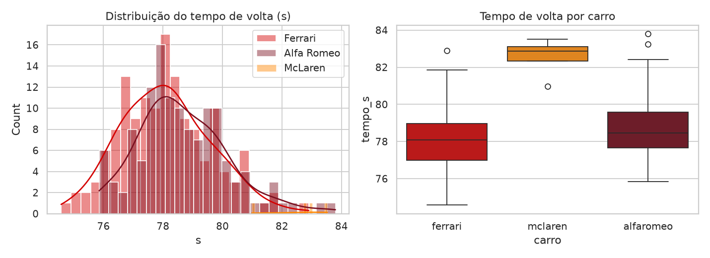

Fonte: Elaborada pelo autor (2026), com dados de `voltas.csv`. Nota: a McLaren (4 voltas, S0) aparece apenas como referência.

A telemetria confirma o perfil da pista. A maior velocidade registrada foi de 289 km/h (Ferrari, S0), a 1.976 m da linha de chegada, na região do túnel. O trecho mais lento fica em torno de 1.250 m (média de 50 km/h, no Grampo Loews). A marcha mais usada é a 2ª (25,5% do tempo em movimento), e a 8ª aparece em apenas 0,4% dele. O setor 2, que ocupa cerca de 48% do tempo de volta, é o mais lento (133,7 km/h de média) e o que mais se correlaciona com o tempo total (Pearson, r = 0,86). O tempo de volta se associa mais à velocidade média (ρ = −0,46) do que à velocidade máxima (ρ = −0,29). Em Mônaco, portanto, a velocidade nas curvas pesa mais do que a velocidade final (Figuras 2 e 3).

Figura 2 – Mapa de calor da velocidade por posição em Mônaco

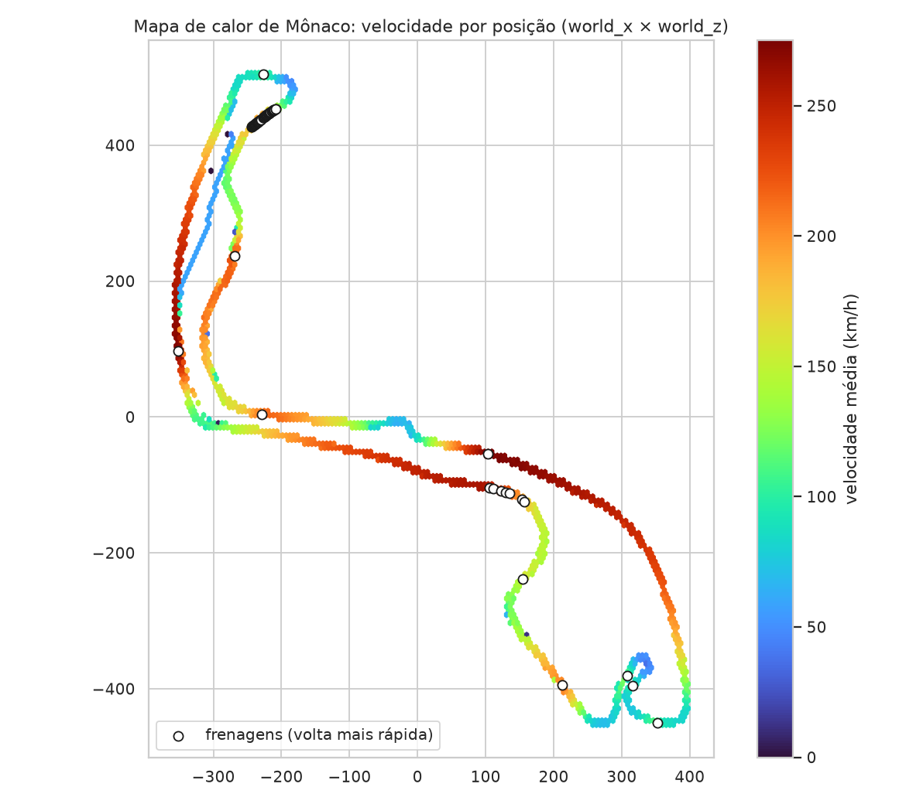

Fonte: Elaborada pelo autor (2026), com dados de `amostras.csv`. Nota: mapa reconstruído a partir das coordenadas `world_x` e `world_z`; os pontos brancos marcam as zonas de frenagem da volta mais rápida.

Figura 3 – Velocidade ao longo da volta: volta mais rápida contra a mais lenta

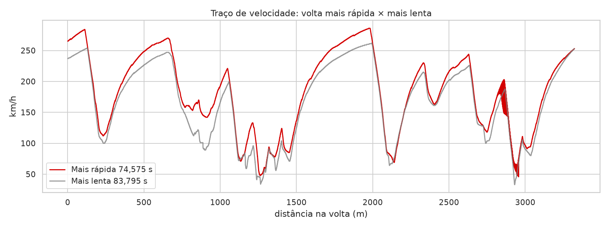

Fonte: Elaborada pelo autor (2026), com dados de `amostras.csv`. Nota: volta mais rápida (74,575 s, Ferrari S10) contra a mais lenta sem volta de saída (83,795 s, Alfa Romeo S2); a maior diferença ocorre entre 850 m e 875 m (+51 km/h).

A idade do pneu se associa positivamente ao tempo (ρ = 0,45; p = 2,8 × 10⁻¹⁵). Sem as voltas de saída, a média passa de 77,346 s na 2ª volta do pneu para 79,206 s na 8ª. Já o combustível no início da volta tem associação fraca e não significativa (ρ = −0,12; p = 0,060). O consumo médio foi de 1,124 kg por volta (Figura 4).

Figura 4 – Efeito do *stint* e do combustível no tempo de volta

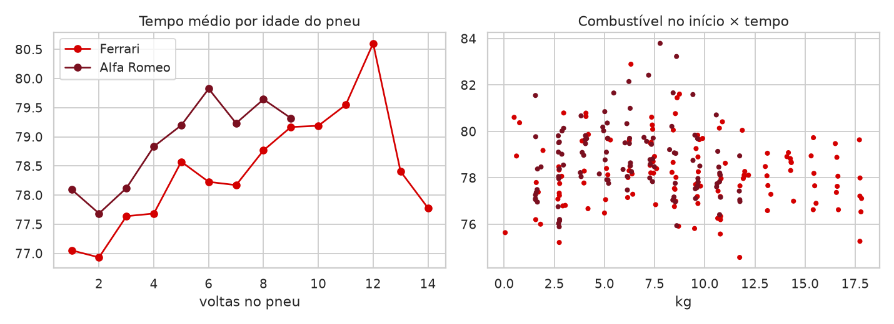

Fonte: Elaborada pelo autor (2026), com dados de `voltas.csv`. Nota: à esquerda, tempo médio por idade do pneu; à direita, combustível no início da volta contra o tempo.

Para estimar o ruído do piloto, foram usadas as voltas do S0. O desvio-padrão foi de 1,23 s na Ferrari (34 voltas) e de 1,38 s na Alfa Romeo (11 voltas), com DP combinado de 1,26 s (Figura 5). Esse valor serve de régua: uma diferença de acerto menor do que ele não se distingue da variação natural entre voltas do mesmo piloto.[^ruido]

Figura 5 – Dispersão das voltas no acerto base S0, por carro

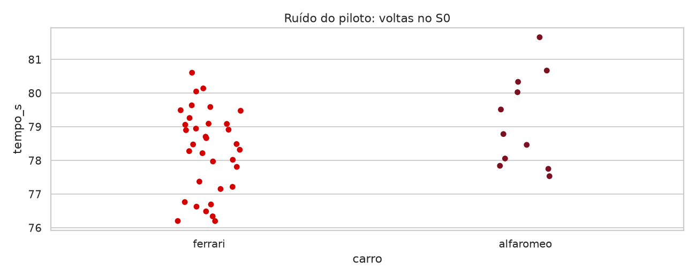

Fonte: Elaborada pelo autor (2026), com dados de `voltas.csv`.

## 3.2 Efeito dos acertos

A Tabela 1 e as Figuras 6 e 7 resumem o efeito de cada acerto em relação ao S0 do mesmo carro.

Tabela 1 – Tempo médio por acerto e diferença em relação ao S0 (s)

| Acerto | Ferrari: média (n) | Δ em relação ao S0 | Alfa Romeo: média (n) | Δ em relação ao S0 |
|---|---|---|---|---|
| S0 | 78,303 (34) | – | 79,151 (11) | – |
| S1 | 77,876 (14) | −0,43 | 77,925 (11) | −1,23 |
| S2 | 79,397 (11) | +1,09 | 81,078 (12) | +1,93 |
| S3 | 77,943 (11) | −0,36 | 78,055 (11) | −1,10 |
| S4 | 78,880 (12) | +0,58 | 78,612 (11) | −0,54 |
| S5 | 77,435 (12) | −0,87 | 78,774 (13) | −0,38 |
| S6 | 78,176 (11) | −0,13 | 78,151 (11) | −1,00 |
| S7 | 77,779 (9) | −0,52 | 79,110 (12) | −0,04 |
| S8 | 78,764 (9) | +0,46 | 78,576 (12) | −0,58 |
| S9 | 77,366 (9) | −0,94 | 78,132 (13) | −1,02 |
| S10 (IA) | 76,767 (12) | −1,54 | 77,596 (12) | −1,55 |

Fonte: Elaborada pelo autor (2026), com dados de `voltas.csv` (273 voltas de Ferrari e Alfa Romeo). Nota: Δ arredondado para duas casas decimais.

Figura 6 – Distribuição do tempo de volta por acerto e carro

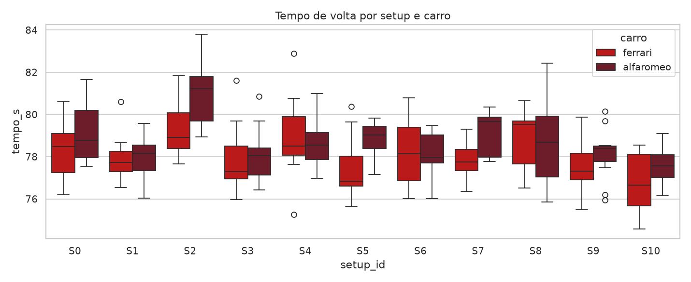

Fonte: Elaborada pelo autor (2026), com dados de `voltas.csv`.

Figura 7 – Diferença média de cada acerto em relação ao S0 do próprio carro

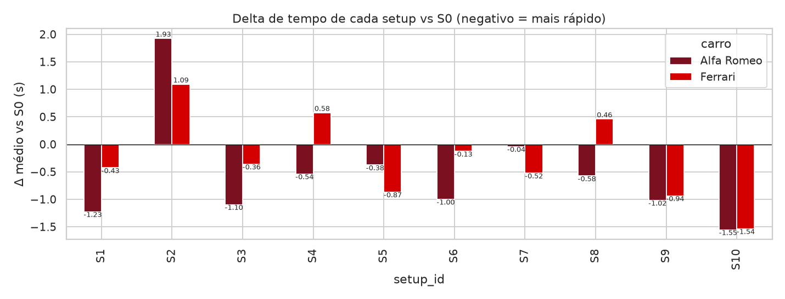

Fonte: Elaborada pelo autor (2026), com dados de `voltas.csv`. Nota: valores negativos indicam voltas mais rápidas.

O S10, sugerido pela IA, foi o melhor acerto nos dois carros: −1,54 s na Ferrari e −1,55 s na Alfa Romeo. Foi também o acerto mais consistente da Alfa Romeo (DP = 0,87 s). O S2 (diferencial sem aceleração em 80) foi o pior nos dois carros, com +1,93 s na Alfa Romeo e +1,09 s na Ferrari. Na Alfa Romeo, a perda do S2 se concentra no setor 2 (+1,50 s, contra −0,03 s no setor 1 e +0,47 s no setor 3), como mostra a Figura 8. A telemetria situa a maior perda de velocidade em torno de 1.200 m (−12,7 km/h, região do Grampo). O S10, por sua vez, ganha em média 3,0 km/h, com pico de +20,6 km/h por volta de 950 m (Figura 9). Na Ferrari, o S10 foi mais rápido em todos os setores (−0,41 s no setor 1, −0,87 s no setor 2 e −0,26 s no setor 3).

Figura 8 – Alfa Romeo: diferença média por setor de cada acerto em relação ao S0

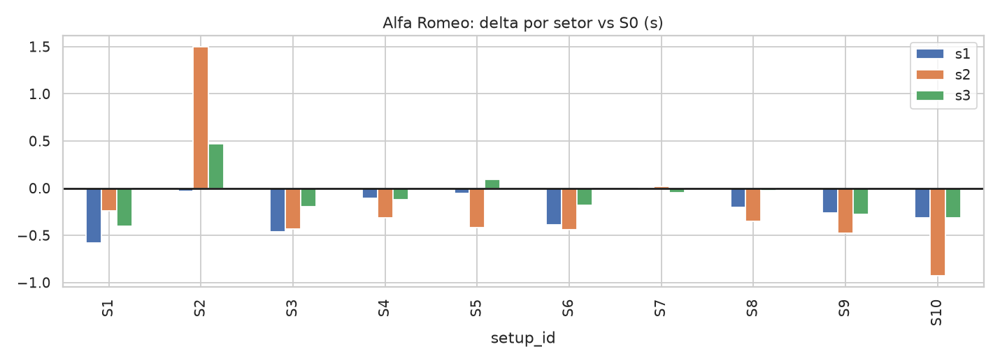

Fonte: Elaborada pelo autor (2026), com dados de `voltas.csv`.

Figura 9 – Alfa Romeo: diferença de velocidade média por posição na volta (S10 − S0 e S2 − S0)

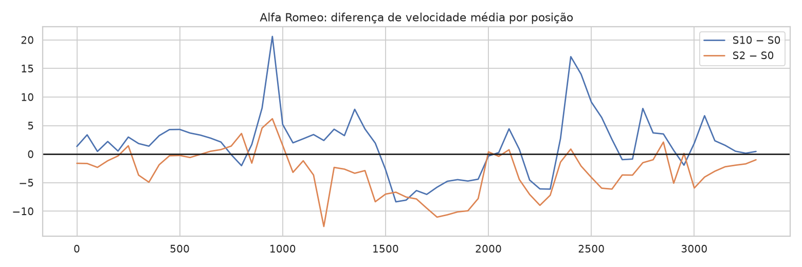

Fonte: Elaborada pelo autor (2026), com dados de `amostras.csv`.

Apesar dessas tendências, apenas 3 das 20 comparações com o S0 foram estatisticamente significativas (Mann-Whitney, α = 5%): Alfa Romeo S2, Alfa Romeo S10 e Ferrari S10. São também as únicas diferenças maiores que o ruído do piloto (1,26 s). Dos 10 acertos alternativos, 9 melhoraram a média da Alfa Romeo e 7 a da Ferrari. A concordância entre os rankings dos dois carros foi positiva, mas não significativa (Spearman, ρ = 0,49; p = 0,150).

## 3.3 Importância das variáveis

Os seis métodos de importância apontaram o mesmo trio no topo (Figura 10). No consenso normalizado, a idade do pneu respondeu por 42,7% da importância, o diferencial sem aceleração (*off-throttle*) por 26,0% e o carro (Ferrari) por 15,0%. Em seguida vêm a convergência dianteira (3,4%) e o combustível do acerto (2,2%). A idade do pneu ficou na mesma posição em todos os métodos. A convergência dianteira, ao contrário, variou 17 posições: o Lasso a valorizou, e os modelos de árvore praticamente a ignoraram.

O Lasso (LassoCV) zerou 11 das 24 variáveis. Os maiores coeficientes, em segundos por desvio-padrão, foram: idade do pneu, +0,667; diferencial sem aceleração, +0,540; carro Ferrari, −0,420; e convergência dianteira, −0,252. Os sinais são coerentes com a análise exploratória: pneu mais gasto e diferencial mais travado na desaceleração pioram o tempo, e a Ferrari é mais rápida.

Figura 10 – Importância média normalizada das 12 principais variáveis (%)

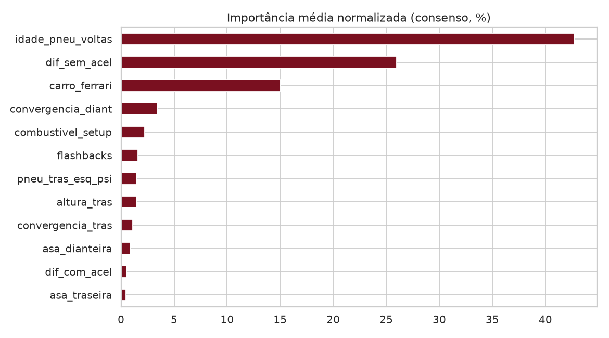

Fonte: Elaborada pelo autor (2026), com dados de `importancias.csv`. Nota: consenso de seis métodos (coeficiente do Lasso, impureza em RF e GBM, permutação em RF, Lasso e GBM).

## 3.4 Desempenho preditivo: tempo de volta

A Tabela 2 apresenta os resultados da modelagem principal, com hiperparâmetros fixos ou ajustados internamente (LassoCV e RidgeCV).

Tabela 2 – Tempo de volta: métricas da validação cruzada agrupada (CV) e do teste *hold-out*

| Modelo | MAE CV (s) | RMSE CV (s) | R² CV | MAE teste (s) | R² teste |
|---|---|---|---|---|---|
| Baseline (média) | 1,219 | 1,557 | −0,03 | 1,164 | −0,08 |
| Só carro (linear) | 1,226 | 1,550 | −0,02 | 1,179 | −0,11 |
| Lasso (LassoCV) | 1,015 | 1,274 | 0,31 | 1,060 | 0,19 |
| Ridge (RidgeCV) | 1,125 | 1,454 | 0,10 | 1,105 | 0,15 |
| Random Forest | 1,062 | 1,360 | 0,22 | 1,238 | −0,04 |
| Gradient Boosting | 1,089 | 1,354 | 0,22 | 1,141 | 0,06 |
| Extra Trees | 1,076 | 1,375 | 0,20 | 1,282 | −0,11 |

Fonte: Elaborada pelo autor (2026), com dados de `metricas_modelos.csv`.

Figura 11 – MAE e R² na validação cruzada e no teste para o tempo de volta

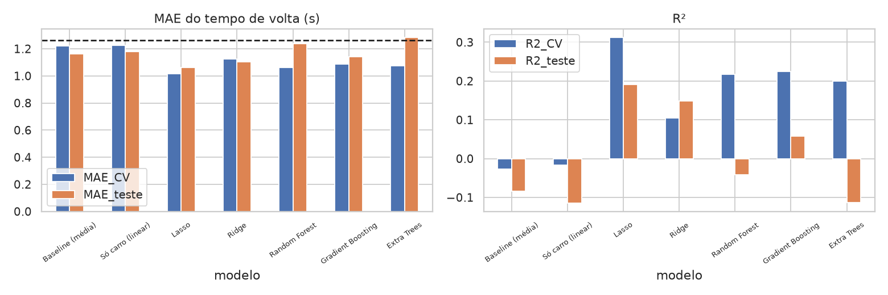

Fonte: Elaborada pelo autor (2026), com dados de `metricas_modelos.csv`.

Para isolar o efeito do ajuste de hiperparâmetros, cada algoritmo foi avaliado em duas versões: com a configuração padrão do scikit-learn e com a busca aleatória em validação aninhada (Tabela 3 e Figura 12). Antes do ajuste, o melhor modelo foi o Gradient Boosting, com MAE CV de 1,130 s.[^gbm] Depois do ajuste, os lineares regularizados passaram à frente: ElasticNet com 1,008 s (R² CV = 0,33) e Lasso com 1,017 s (R² CV = 0,32). A diferença entre os dois, de 0,009 s, é desprezível.

Tabela 3 – Tempo de volta: MAE antes e depois do ajuste de hiperparâmetros (CV aninhada, em segundos)

| Modelo | MAE CV padrão | MAE CV ajustado | Variação | MAE teste padrão | MAE teste ajustado |
|---|---|---|---|---|---|
| ElasticNet | 1,184 | 1,008 | −14,9% | 1,093 | 1,049 |
| Lasso | 1,219[^lasso] | 1,017 | −16,5% | 1,164 | 1,086 |
| Gradient Boosting | 1,130 | 1,049 | −7,1% | 1,158 | 1,075 |
| Extra Trees | 1,239 | 1,094 | −11,7% | 1,184 | 1,024 |
| Random Forest | 1,153 | 1,097 | −4,8% | 1,234 | 1,184 |
| Ridge | 1,179 | 1,143 | −3,1% | 1,144 | 1,075 |
| MLP (rede neural) | 1,147 | 1,365 | +19,0% (piora) | 1,135 | 0,977 |
| Baseline (média) | 1,219 | – | – | 1,164 | – |

Fonte: Elaborada pelo autor (2026), com dados de `hiperparametros/resumo_mae.csv`.

Figura 12 – MAE da validação cruzada agrupada antes e depois do ajuste de hiperparâmetros

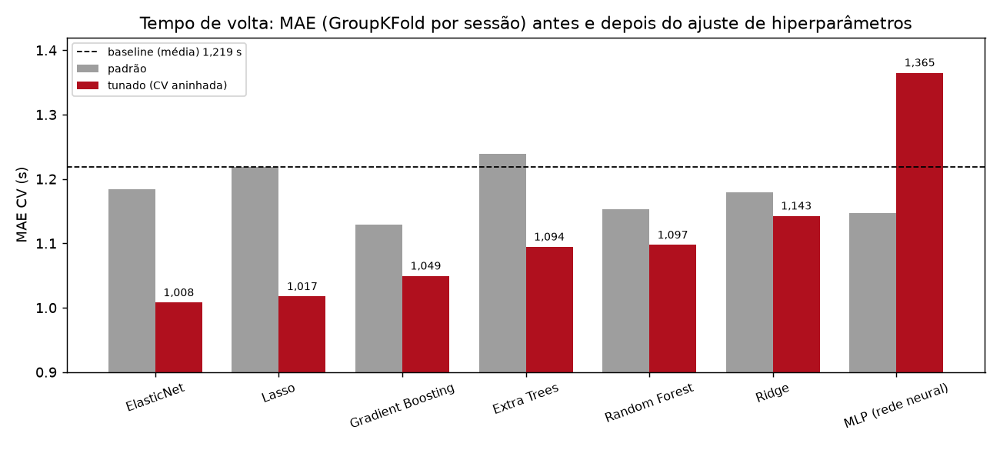

Fonte: Elaborada pelo autor (2026), com dados de `hiperparametros/resumo_mae.csv`. Nota: cinza, configuração padrão; vermelho, configuração ajustada; a linha tracejada indica o *baseline* (1,219 s).

Os melhores hiperparâmetros encontrados foram: Lasso com α = 0,140; Ridge com α = 41,4; ElasticNet com α = 0,411 e `l1_ratio` = 0,55; RF com 465 árvores, profundidade máxima 5, folha mínima 9 e `max_features` = 0,5; ET com 328 árvores, folha mínima 3 e `max_features` = 0,3; GBM com 402 árvores de profundidade 1 (*stumps*), taxa de aprendizado 0,011 e subamostragem 0,92; MLP com camadas (32, 16) e α = 0,018. Nos modelos de árvore, a busca escolheu sistematicamente estruturas mais simples, o que condiz com o tamanho da amostra. A MLP piorou na CV depois do ajuste (1,365 s), mas teve o menor MAE no *hold-out* (0,977 s). Como o *hold-out* tem apenas 57 voltas, esse resultado foi interpretado como instabilidade, e não como superioridade. A Figura 13 mostra a dispersão entre valores previstos e reais no teste para o Lasso.

Figura 13 – Tempo previsto contra tempo real nas sessões de teste (Lasso)

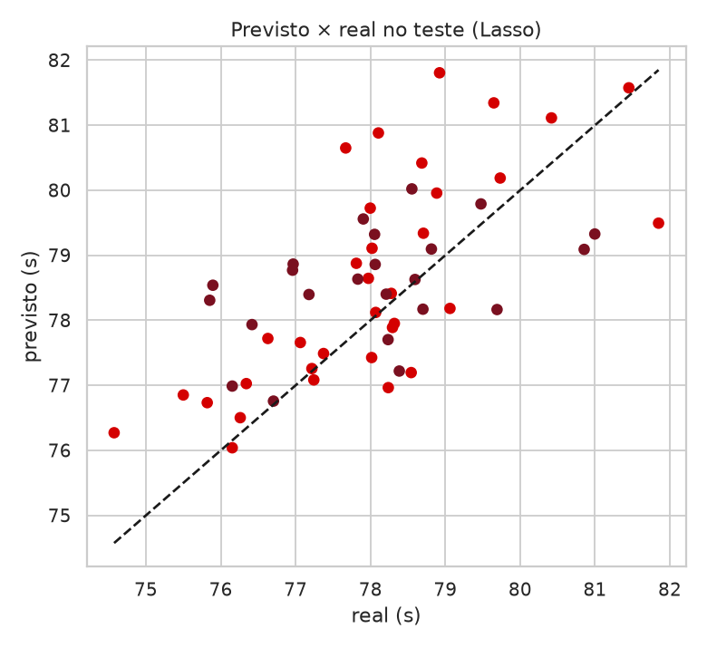

Fonte: Elaborada pelo autor (2026), com dados de `voltas.csv`. Nota: a linha tracejada indica a previsão perfeita.

Como contraponto, um RF treinado apenas com agregados de telemetria (velocidades em curva, aceleração lateral média e percentuais de acelerador e de freio) atingiu MAE CV de 0,820 s e R² de 0,52. As variáveis mais relevantes foram a aceleração lateral média, a velocidade máxima no túnel e o percentual do tempo freando (Figura 14). Esse modelo não serve para prever o efeito de um acerto antes da volta, mas indica que a informação que falta ao modelo de acerto está na execução da volta.

Figura 14 – Importância por permutação no modelo explicativo de telemetria

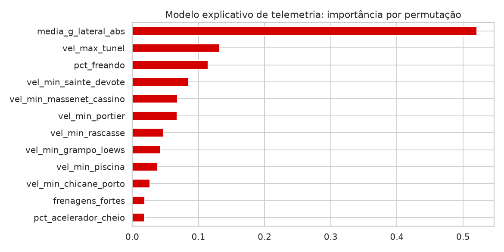

Fonte: Elaborada pelo autor (2026), com dados de `voltas.csv`. Nota: modelo não usado para prever o efeito de acertos.

## 3.5 Desempenho preditivo: velocidades máxima e média

A Tabela 4 compara, para os dois alvos de velocidade, o melhor modelo com o *baseline*.

Tabela 4 – Velocidades: melhor modelo contra o *baseline* (MAE em km/h)

| Alvo | Melhor modelo | MAE CV | R² CV | MAE teste | MAE CV do *baseline* | MAE teste do *baseline* |
|---|---|---|---|---|---|---|
| Velocidade máxima | Random Forest | 5,16 | 0,10 | 4,54 | 5,72 | 4,84 |
| Velocidade média | Lasso | 3,99 | 0,59 | 3,09 (R² = 0,77) | 7,10 | 6,83 |

Fonte: Elaborada pelo autor (2026), com dados de `metricas_modelos.csv`.

Na velocidade máxima, o melhor modelo (RF, MAE CV de 5,16 km/h) supera o *baseline* (5,72 km/h) por pouco, com R² CV de apenas 0,10, e os lineares regularizados praticamente reproduziram a média. Na velocidade média, o Lasso reduziu o erro de 7,10 km/h para 3,99 km/h (R² CV = 0,59), e o RF ficou próximo, com 4,08 km/h (Figura 15).[^vel]

Figura 15 – MAE da validação cruzada agrupada para os três alvos

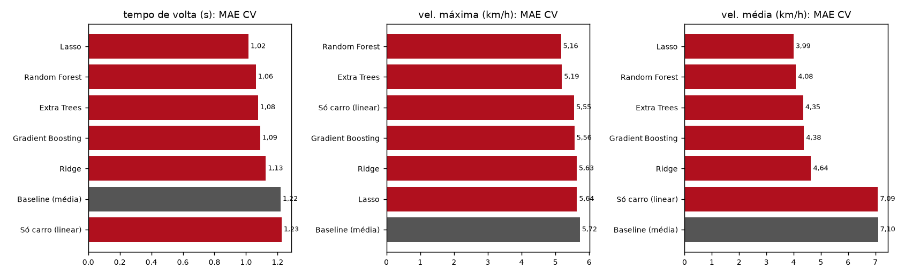

Fonte: Elaborada pelo autor (2026), com dados de `metricas_modelos.csv`. Nota: as barras cinza indicam o *baseline* (média).

# 4 DISCUSSÃO

## 4.1 Variáveis mais relevantes

O desgaste do pneu foi o fator dominante, à frente de qualquer parâmetro de acerto, o que é coerente com uma pista de tração em que a borracha se degrada rapidamente. Entre os parâmetros de acerto, o diferencial sem aceleração se destacou de forma consistente. Fisicamente, um diferencial muito travado na desaceleração dificulta a rotação do carro na entrada das curvas lentas, como o Grampo, a Rascasse e a Sainte-Dévote. O resultado do S2, com perda concentrada no setor 2 e em torno de 1.200 m, reforça essa interpretação. O peso do carro no modelo (a Ferrari foi, em média, 0,57 s mais rápida) mostra que o modo com desempenho real captou diferenças entre as equipes.

## 4.2 Acertos versus ruído do piloto

O ponto central do estudo é a comparação com o ruído do piloto. Com DP de 1,26 s entre voltas do mesmo acerto, apenas o S10 (nos dois carros) e o S2 (na Alfa Romeo) produziram efeitos claramente distinguíveis. O S10 ganhou cerca de 1,5 s, enquanto a maior parte dos ajustes isolados ficou dentro do ruído. Isso sugere que, em Mônaco, o ganho vem da combinação de ajustes, e não de uma única mudança. O desenho experimental, porém, não permite atribuir o ganho do S10 a parâmetros específicos, porque doze valores mudaram ao mesmo tempo.

## 4.3 Escolha do modelo

Com 273 voltas e 24 preditores, os lineares regularizados (ElasticNet e Lasso) generalizaram melhor que os conjuntos de árvores e que a MLP. O ajuste de hiperparâmetros melhorou todos os modelos clássicos entre 3% e 17%, mas o ganho absoluto ficou entre 0,04 s e 0,20 s. O melhor MAE, de cerca de 1,0 s, supera o *baseline* em aproximadamente 0,2 s e é da mesma ordem de grandeza do ruído do piloto; o R² máximo, de 0,33, indica que a maior parte da variância não é explicada pelo acerto. O bom desempenho do modelo explicativo de telemetria (MAE de 0,82 s) reforça que essa variância restante está na execução da volta: traçado, pontos de frenagem e velocidade em curva.

A rede neural foi incluída como exploração de *deep learning*. O comportamento instável, com piora na CV após o ajuste e melhora no *hold-out*, ilustra como um conjunto de teste pequeno pode enganar e por que a validação agrupada e aninhada deve ser o critério de seleção.

## 4.4 Limitações e ameaças à validade

Algumas limitações devem ser consideradas na leitura dos resultados:

a) combustível: a carga registrada no acerto variou de 5 kg a 20 kg. Na Ferrari, o S0 mistura voltas com 13 kg e 20 kg, os acertos S1 a S4 rodaram com 20 kg e o S7 com 5 kg; na Alfa Romeo, 2 ou 3 voltas de cada acerto registram 5 kg e as demais, entre 12 kg e 14 kg. Parte das diferenças atribuídas ao acerto pode, portanto, vir da diferença de peso;

b) bases diferentes de S0: o S0 da Ferrari inclui voltas com valores distintos do S0 nominal (asa 45/45, balanço de freio de 52% ou 62% e 20 kg de combustível), de modo que os Δ dos dois carros partem de bases ligeiramente diferentes;

c) composto: o pneu duro só aparece na Ferrari (S0, S1 e S6), o que confunde o efeito do composto com o do acerto;

d) aprendizado do piloto: os tempos médios melhoram de uma sessão para outra (na Ferrari, por exemplo, 78,51 s, 77,79 s e 77,60 s), e a ordem das sessões interfere no efeito estimado do acerto;

e) qualidade da captura: a marcação de volta de saída parece imprecisa, já que essas voltas não foram mais lentas (−0,80 s em média), e há picos fisicamente impossíveis de aceleração lateral (48,6 g), que exigem limpeza;

f) generalização: um único piloto, uma única pista e um simulador limitam a extrapolação para a Fórmula 1 real.

# 5 CONCLUSÃO

Este trabalho construiu um “engenheiro de corrida virtual” para Mônaco no F1 23, cobrindo todas as etapas: captura de telemetria UDP em Python, experimento controlado com onze acertos e dois carros, modelagem com validação agrupada por sessão e publicação dos modelos em uma API. Os principais achados foram os seguintes:

a) a idade do pneu (42,7%), o diferencial sem aceleração (26,0%) e o carro (15,0%) concentram a importância preditiva do tempo de volta;

b) o acerto multifatorial S10, sugerido por IA, reduziu o tempo médio em cerca de 1,5 s nos dois carros e produziu a volta mais rápida do conjunto (74,575 s, Ferrari), enquanto o S2 foi o pior acerto (+1,93 s na Alfa Romeo);

c) apenas 3 das 20 comparações de acerto superaram o ruído do piloto (1,26 s);

d) após o ajuste em validação aninhada, o ElasticNet (MAE de 1,008 s) e o Lasso (1,017 s) superaram o melhor modelo na configuração padrão (GBM, 1,130 s), e o ruído do piloto aparece como limite prático do erro;

e) a velocidade média é bem prevista (Lasso, 3,99 km/h contra 7,10 km/h do *baseline*), mas a velocidade máxima quase não é (RF, 5,16 km/h contra 5,72 km/h).

Como trabalhos futuros, propõe-se fixar o combustível e o composto entre os acertos; sortear a ordem dos acertos, para neutralizar o aprendizado do piloto; aumentar o número de voltas por acerto, a fim de ganhar poder estatístico; usar um planejamento fatorial fracionado para decompor o efeito do S10; e incorporar variáveis de execução, como a velocidade mínima nas curvas, em um modelo de dois estágios, no qual o acerto prevê a execução e a execução prevê o tempo.

[^autor]: Discente do curso de Gestão de Tecnologia da Faculdade de Educação e Cultura Francisco Antônio Fernandes (FECAF).

[^plano]: O documento de planejamento (`setups_f123.md`) descreve o S2 com diferencial sem aceleração em 30 e o S7 com altura 25/45. Os valores efetivamente registrados pela telemetria são 80 e 30/45, respectivamente, e foram os adotados neste artigo. O S1 registrado também altera o diferencial sem aceleração de 53 para 50, além de levar o diferencial com aceleração a 80.

[^limpeza]: A página do projeto menciona a remoção de voltas de saída, de entrada no box e com *flashback*. Os scripts de modelagem (`analise.py` e `tuning.py`), porém, mantêm as 273 voltas e tratam essas condições como variáveis. Este artigo descreve o procedimento dos scripts.

[^ruido]: O valor de 1,52 s citado em materiais anteriores do projeto como “ruído do piloto” corresponde ao DP de todas as voltas da Ferrari, que mistura o efeito do piloto e o do acerto. A medida restrita ao S0 é 1,26 s.

[^gbm]: A análise principal (Tabela 2) usou um GBM com hiperparâmetros escolhidos manualmente (300 árvores, profundidade 2), que obteve 1,089 s. O valor de 1,130 s refere-se ao GBM com a configuração padrão do scikit-learn no experimento de ajuste (Tabela 3). Excluído o Lasso padrão, que coincide com o *baseline*, o GBM é o melhor modelo nessa condição.

[^lasso]: Com α = 1 (padrão do scikit-learn), o Lasso zera todos os coeficientes e reproduz o *baseline*.

[^vel]: Não foi feita análise de importância de variáveis específica para os alvos de velocidade. É plausível que parte do desempenho na velocidade média venha dos indicadores `entrou_box` e `volta_saida`, mas essa hipótese não foi testada. Também não há, nos arquivos do projeto, ajuste de hiperparâmetros para esses dois alvos; os valores da Tabela 4 vêm da modelagem principal. Um resultado de “RF 1,03 s no teste”, citado em materiais anteriores, vem de outra partição entre treino e teste, não é reproduzível com os arquivos atuais e, por isso, não foi usado.

<!-- quebra -->

# REFERÊNCIAS {.unnumbered}

BERGSTRA, J.; BENGIO, Y. Random search for hyper-parameter optimization. **Journal of Machine Learning Research**, [*s. l.*], v. 13, p. 281-305, 2012.

BREIMAN, L. Random forests. **Machine Learning**, [*s. l.*], v. 45, n. 1, p. 5-32, 2001.

ELECTRONIC ARTS. **Data output from F1 23**: especificação do protocolo UDP de telemetria. [*S. l.*]: Electronic Arts; Codemasters, 2023. Documentação publicada nos fóruns oficiais da EA. Cópia de referência disponível em: https://github.com/MacManley/f1-23-udp. Acesso em: 26 out. 2026.

FRIEDMAN, J. H. Greedy function approximation: a gradient boosting machine. **The Annals of Statistics**, [*s. l.*], v. 29, n. 5, p. 1189-1232, 2001.

GEURTS, P.; ERNST, D.; WEHENKEL, L. Extremely randomized trees. **Machine Learning**, [*s. l.*], v. 63, n. 1, p. 3-42, 2006.

HASTIE, T.; TIBSHIRANI, R.; FRIEDMAN, J. **The elements of statistical learning**: data mining, inference, and prediction. 2. ed. New York: Springer, 2009.

HOERL, A. E.; KENNARD, R. W. Ridge regression: biased estimation for nonorthogonal problems. **Technometrics**, [*s. l.*], v. 12, n. 1, p. 55-67, 1970.

KUHN, M.; SILGE, J. **Tidy modeling with R**. Sebastopol: O'Reilly, 2022. Disponível em: https://www.tmwr.org/. Acesso em: 26 out. 2026.

MANN, H. B.; WHITNEY, D. R. On a test of whether one of two random variables is stochastically larger than the other. **The Annals of Mathematical Statistics**, [*s. l.*], v. 18, n. 1, p. 50-60, 1947.

MARCELINO, A. **f1-ml-monaco**: engenheiro de corrida virtual – F1 23 Mônaco (código, dados e modelos). [*S. l.*]: GitHub, 2026a. Disponível em: https://github.com/andremarcelino-mp4/f1-ml-monaco. Acesso em: 26 out. 2026.

MARCELINO, A. **Engenheiro de corrida virtual**: F1 23 Mônaco – página do projeto e simulador interativo. [*S. l.*], 2026b. Disponível em: https://f1-monaco-landing.vercel.app/. Acesso em: 26 out. 2026.

PEDREGOSA, F. *et al*. Scikit-learn: machine learning in Python. **Journal of Machine Learning Research**, [*s. l.*], v. 12, p. 2825-2830, 2011.

SIMRACINGSETUP. **F1 23 Monaco setup**: acerto TimeTrialKing. [*S. l.*], [2023?]. Disponível em: https://simracingsetup.com/. Acesso em: 26 out. 2026.

SPEARMAN, C. The proof and measurement of association between two things. **The American Journal of Psychology**, [*s. l.*], v. 15, n. 1, p. 72-101, 1904.

TIBSHIRANI, R. Regression shrinkage and selection via the lasso. **Journal of the Royal Statistical Society: Series B (Methodological)**, [*s. l.*], v. 58, n. 1, p. 267-288, 1996.

VARMA, S.; SIMON, R. Bias in error estimation when using cross-validation for model selection. **BMC Bioinformatics**, [*s. l.*], v. 7, art. 91, 2006.

ZOU, H.; HASTIE, T. Regularization and variable selection via the elastic net. **Journal of the Royal Statistical Society: Series B (Statistical Methodology)**, [*s. l.*], v. 67, n. 2, p. 301-320, 2005.
